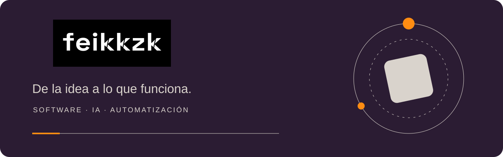

  

<h1 align="center">🚀 Ideas que se convierten en soluciones</h1>

Desarrollamos software a la medida e integramos inteligencia artificial 
para simplificar procesos y crear herramientas útiles para tu negocio.

  <a href="https://github.com/feikkzk"><strong>🌐 Conoce nuestro perfil</strong></a>
  &nbsp;·&nbsp;
  <a href="https://github.com/feikzk"><strong>💬 Conecta con nosotros</strong></a>

## 🛠️ Qué hacemos

| | Soluciones para tu negocio |
| --- | --- |
| 💻 **Software a la medida** | Aplicaciones web, plataformas y herramientas internas. |
| 🧠 **Inteligencia artificial** | Asistentes y agentes conectados con el conocimiento de tu negocio. |
| ⚡ **Automatización e integraciones** | Procesos más simples y sistemas que trabajan juntos. |
| 🌱 **Evolución de productos** | Mantenimiento, mejoras e incorporación de IA en software existente. |

## 🤝 Cómo trabajamos

**🔍 Entendemos → 🎯 Definimos → 🛠️ Construimos → 🚀 Entregamos → 📈 Mejoramos**

Avanzamos con entregas incrementales y validación continua, priorizando software útil, mantenible y alineado con tus objetivos.

## 📂 Acerca de este repositorio

Aquí mantenemos la presentación pública y los recursos de identidad de **feikkzk**.

- [**Presentación de la empresa**](./profile/README.md): contenido que aparece en el perfil público de la organización.
- [**Recursos visuales**](./profile/assets/): banner e identidad visual del perfil.

---

<strong>feikkzk · Software a la medida con inteligencia artificial.</strong>

## Identidad visual

Ciruela Eclipse `#2B1C33` · 60 %, Seda Titanio `#D9D3CC` · 30 %, Destello Ámbar `#FF8C12` · 10 %. Una base ciruela, lectura titanio y acentos ámbar. Logo monocromo elegido con cortes en las tres k.

[Sistema de diseño](https://github.com/feikkzk/brand-design) · [Landing page](https://github.com/feikkzk/landing-page).
<<<<<<< HEAD

La galería, el cursor y el sonido de los proyectos comparten las reglas de movimiento de feikkzk. [Guía de movimiento y audio](https://github.com/feikkzk/brand-design/blob/main/docs/motion.md) · [Contrato de interacción](https://github.com/feikkzk/brand-design/blob/main/ui-contract.json).
=======
>>>>>>> 9ba508aa9c2a73005487fc1464fbd5042913adfe
